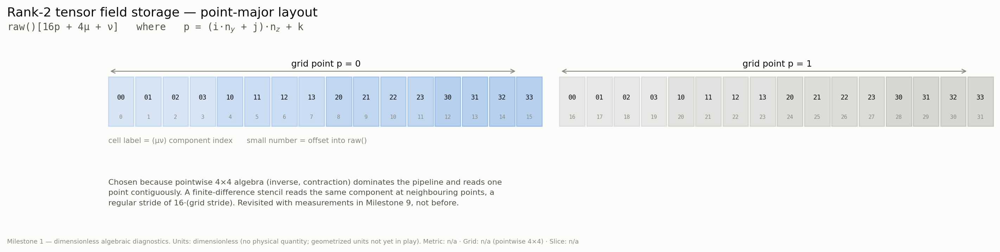

# Grid indexing and memory layout

Everything here is verified exhaustively by the `grid.*` and `layout.*` cases in
`results/verification/milestone_01/`, and is mirrored into every run's
`metadata.json` so an exported field dump can be read without this document.

## Grid index

    p = (i · n_y + j) · n_z + k          i ∈ [0, n_x), j ∈ [0, n_y), k ∈ [0, n_z)

z varies fastest, then y, then x. Strides in flat-index units:

| Step | Stride |
|---|---|
| +1 in x | `n_y · n_z` |
| +1 in y | `n_z` |
| +1 in z | `1` |

Verified: the map is a bijection onto `[0, N)` (no collisions, no gaps, nothing
out of range), round-trips in both directions at every point, and the stride
accessors agree with `flat()` — all exhaustively, on both a 41³ cube and an
asymmetric 17×9×5 grid. The asymmetric grid matters: on a cube, transposing two
axes is invisible.

## Coordinate generation

    x_i = x_min · (1 − t) + x_max · t,     t = i / (n − 1)

then the two endpoints — and, for odd `n`, the midpoint — are pinned to their
exact values.

The alternative `x_min + i·dx` accumulates up to `n` ulp of drift and generally
does not land on `x_max` at all.

The trade this makes is explicit: three coordinates are **exactly** right, and
the spacing is therefore uniform only to within a few ulp rather than bit-exactly.
The gate tests it that way — endpoints and midpoint with `==`, uniformity at
1e-12 relative. Measured worst case is 3.6e-15 on the 41³ grid and exactly 0 on
the 17×9×5 grid.

## Field storage — point-major

All components at one grid point are adjacent, component index varying fastest.

| Rank | Components per point | Offset into `raw()` |
|---|---|---|
| scalar | 1 | `p` |
| 2 | 16 | `16p + 4μ + ν` |
| 3 | 64 | `64p + 16a + 4b + c` |
| 4 | 256 | `256p + 64a + 16b + 4c + d` |

### Why point-major

The dominant cost is pointwise 4×4 algebra: inverting gμν,
contracting Christoffels, assembling Ricci. Those touch all 16 (or 64, or 256)
components of a single point together and do O(4³)–O(4⁴) work per point.
Point-major makes each of those a dense sequential read.

Finite differencing wants the opposite — the same component at neighbouring
points — which under point-major is a strided read of stride `16 · (grid
stride)`. But differencing is only O(1) work per component per point, so it is
the cheaper side of the trade, and the access pattern stays regular and
prefetchable.

The trade tilts further toward point-major once `HyPADScalar` replaces `double`,
because the pointwise algebra grows with the number of derivative channels while
the stencil arithmetic does not change shape.

**This decision is revisited with measurements in Milestone 9, not before.**

### How the layout is verified

Two distinct checks, because either alone is insufficient:

1. **Round-trip.** Every component is written with a tag encoding its own full
   index, then read back and compared exactly. Because each tag is a distinct
   integer, a transposition reads back a *different index tuple* rather than
   merely a wrong number — the failure identifies the bug.

2. **Documented offset.** The raw buffer is indexed directly by the formulas in
   the table above and compared against the same tags. The round-trip check
   alone would pass for any self-consistent addressing scheme; this one pins the
   layout that an external reader of an exported dump actually depends on.

Both run exhaustively over 385 points — 98,560 components for rank 4.

The rank-4 tag uses strides of 1e9/1e7/1e5 rather than 1e6/1e4/1e2. The
component index reaches 255, which overflows a stride of 100 and would let tags
collide across different `k`, silently weakening the test.
